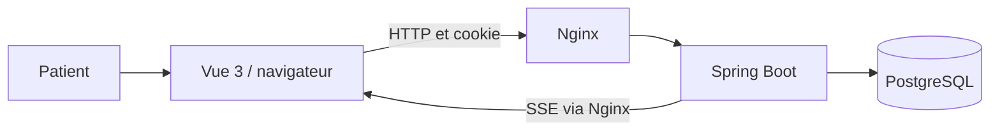

# Architecture de MediSlot

## C4 : contexte et conteneurs

Le patient recherche et réserve un rendez-vous. Le navigateur exécute Vue. Nginx sert les fichiers et transmet /api au monolithe Spring Boot. Celui-ci applique les règles et interroge PostgreSQL. Aucun prestataire de santé ou d’envoi d’e-mail réel n’est intégré.

## Répartition

- `api` reçoit les demandes, valide les DTO et construit les réponses.
- `application` applique réservation, annulation et déplacement dans une transaction.
- `domain` contient les données métier persistantes.
- `repository` utilise Spring Data JPA et les verrous PostgreSQL.
- `security` protège les routes, l’identité et le CSRF.
- `realtime` diffuse les signaux après commit et nettoie les connexions.

Les modules métier pourraient être isolés en packages `directory`, `booking`, `identity` et `notification`. La correction utilise d’abord des couches explicites, puis la séance 9 propose le refactoring vers un monolithe modulaire. Elle ne prétend pas appliquer intégralement une architecture hexagonale.

## Invariants

Un créneau ne possède qu’un rendez-vous CONFIRMED. Le patient provient de la session, jamais du corps de la demande. Une annulation garde l’historique. Un déplacement valide le nouveau créneau avant de remplacer l’ancien dans la même transaction. Les verrous sur deux créneaux suivent l’ordre de leurs identifiants.

## Données

app_user, professional, slot, appointment, audit_event et notification. Le schéma versionné Flyway est la référence de la base. Les DTO de réponse sont distincts des entités. Les clés étrangères protègent les références. Un index partiel unique protège l’invariant même si une autre entrée applicative oublie le verrou.

## Performance

Les recherches sont paginées avec ordre stable name puis id. Les créneaux portent un index professionnel/date. Les appels aux disponibilités des cartes sont parallèles ; leur nombre reste limité à six cartes. Un endpoint groupé, des projections et une temporisation des rafraîchissements SSE sont des évolutions à mesurer. L’objectif pédagogique est de justifier chaque optimisation par une observation.
